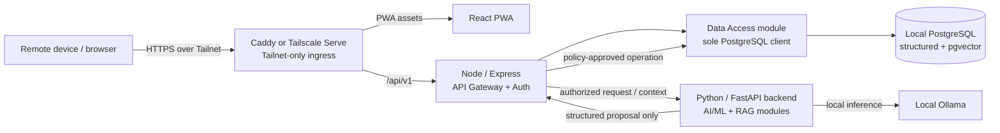

# TimeMem 現行系統架構

## 範圍與依據

本文件只將已批准的決策轉成架構描述，並在各項設計旁標示 D-ID。M0 需求仍是 Draft；範圍未決或只見於 Draft 決策的內容一律標示 TBD，不作已定設計。舊計劃已移至 [archive/IMPLEMENTATION_PLAN.md](./archive/IMPLEMENTATION_PLAN.md)，僅供歷史參考。

CR-004 / D-025 記錄兩條隔離路線：家庭閉環使用 **App + 本機 PostgreSQL / pgvector + Ollama**；公開 POC 可使用 Supabase / Cloud，但只可使用合成／測試資料。真實家庭資料不得送往公開 Cloud、POC 或外部服務；獲授權遠端查看只可經加密 Tailnet 傳送到已授權裝置，裝置 cache 必須加密並於登出或撤銷裝置／session 時清除。POC 的公開安全設計與部署尚待設計及驗證，並非已實作或已通過。

R-011 的政策歧義已由 Joe 決定：加密 Tailnet 傳輸至授權裝置及符合上述條件的本機 cache 獲准；實際加密、清除及撤銷行為仍須在後續實作測試。M0 只測不含資料的 shell。

## Two-track Boundaries and Image References

| Track | Target | Data / access boundary |
|---|---|---|
| 公開 POC | Supabase / Cloud，登入方向為 Supabase Auth；OpenRouter / Railway 為候選。 | 只用合成／測試資料；與家庭環境、資料及憑證隔離。公開授權、濫用防護與部署細節 TBD，不能從供應商名稱推斷已安全。 |
| 家庭閉環 | JOE-SERVER 的 local PostgreSQL + pgvector + Ollama；Tailnet-only ingress，App Passkey / PIN。 | 真實家庭資料及推理不送往公開 Cloud 或外部服務；遠端查看只經加密 Tailnet 到授權裝置，cache 加密並於登出／撤銷時清除；不開 router port；D-024 的單一家庭 Primary 和 DAO 邊界仍適用。 |

附件實際內容經 Joe 確認：`001.png` 是 Hybrid AI Web Architecture，`002.png` 是 Local Development Environment；這與 review HTML 的檔名描述相反。前者是服務分界參考，後者是本機 Docker 開發概念；圖示不批准額外服務或固定容器數目。公開 POC 的實際拓撲、資料流及權限待另行設計。

## Household Closed-loop Service Architecture

This is the approved target topology (D-024), not a claim that the services have been implemented. M0 remains limited to the setup, Tailnet reachability, and PWA-shell checks in D-023.

In the target local environment, Docker Compose coordinates the application services. The development profile uses synthetic/test data with a separate disposable DB; JOE-SERVER is the single writable production Primary. D-024 allows Caddy or Tailscale Serve as the Tailnet-only HTTPS ingress; PostgreSQL, the Python backend, and Ollama remain internal services, not public endpoints. M0 used Tailscale Serve, reported as `tailscale serve --bg http://127.0.0.1:8080`; this records the reported test ingress, not a claim that the future application topology is implemented. No router port may be opened. This is a future deployment view: no compose topology, schema, migration, or product code is created by this architecture decision.

The household mapping follows the instructor's [Gen-AI Reading App](https://github.com/bocyslamventurenixlab/gen-ai-reading-app) service pattern without its Supabase or OpenRouter dependencies. Its single FastAPI backend is represented here as separate AI/ML and RAG modules within one service.

### Local Development and Primary Profiles

| Profile | Target services | Data and access boundary |
|---|---|---|
| Local development | Docker Compose for React PWA, Node/Express Gateway/Auth + DAO, Python/FastAPI AI/ML + RAG, disposable PostgreSQL + pgvector, and local Ollama. | Use synthetic/test data only; never connect the development profile to the production DB or production credentials. Exact Compose profiles and fixtures remain for post-M0 implementation planning. |
| JOE-SERVER Primary | Same application service boundaries, with production PostgreSQL and Ollama on JOE-SERVER; Caddy or Tailscale Serve provides the Tailnet-only HTTPS entry. | JOE-SERVER remains the only writable production Primary; DB files stay under `D:\docker-data\timemem`. No public DB/API/model endpoint or router port. |
| JOE-DESKTOP | Development and recovery host per D-004; it is not a second production Primary. | No production DB synchronization or concurrent production writes. Recovery promotion and fencing remain TBD under D-016. |

## 家庭閉環目標組件

| 組件 | 已有依據的責任 | 範圍／狀態 |
|---|---|---|
| React PWA | 提供家庭使用者介面，所有資料操作均經 `/api/v1`。 | M0 只驗證 app shell 可經 Tailnet 開啟；自然語言輸入 M2、Passkey/login M4、Face ID M5。Reference: D-009, D-023. |
| Tailnet ingress | Caddy reverse proxy or Tailscale Serve, providing Tailnet-only HTTPS access to the application. | Either approved alternative must remain Tailnet-only and must not require a router port. M0 ingress reported: `tailscale serve --bg http://127.0.0.1:8080`. Reference: D-004, D-011, D-024. |
| Node / Express Gateway/Auth | 提供 `/api/v1`、身份驗證／授權及內部服務路由；包含唯一可連 PostgreSQL 的資料存取模組。 | 只有資料存取模組持有 DB credentials；API/UI 不直接連 DB。App login 仍按 D-008／PRD 的後續 milestone 執行，不屬 M0。Reference: D-003, D-008, D-009, D-024. |
| Python / FastAPI backend | 內部 AI/ML + RAG 模組：本機 embedding、候選檢索協作、理解輸入及組織回覆。 | 只接收經授權的 context，回傳結構化候選／理由／建議；不持有 DB credentials、不直接讀寫 PostgreSQL。Reference: D-010, D-024. |
| DB | 本機 PostgreSQL 保存 `families`、`members`、`events`、`todos`、`event_changes`、`inputs`、`photos`、`memories`、`memory_members`、`memory_photos`；D-024 將 pgvector 列為向量儲存目標。 | JOE-SERVER 是唯一可寫 Primary；資料根目錄為 `D:\docker-data\timemem`。pgvector 僅屬架構決定，未批准 schema/table/dimension 或 migration。Reference: D-004–D-007, D-024. |
| Ollama | 在本機執行核准的 embedding／LLM 模型，供 Python backend 使用。 | 不使用外部 LLM；自然語言輸入、confidence、Undo 及故障 fallback 均不屬 M0。Reference: D-010, D-023, D-024. |
| 備份 | 對 PostgreSQL dump、相片原檔及縮圖執行加密備份、還原及驗證。 | 備份置於 D: 的 backups，每晚一次、保留 30 日；每週還原至臨時 DB 驗證；不得直接覆蓋 Primary。離線媒體副本的方案仍為 TBD (D-019 Draft). Reference: D-007. |
| MCP | FR-10 原為 optional read-only 構想。 | 用途、設計及 milestone 待上堂後決定，不屬 M0；D-025 取代舊 MCP timing/design 條款。 |

## 模組分工

- **UI / PWA：** M0 app-shell acceptance only; later milestones add Calendar／今日版、首頁輸入及家庭資料。不得直接連 DB 或直接呼叫 DB 寫入。Reference: D-003, D-009, D-023.
- **Tailnet ingress (Caddy or Tailscale Serve)：** The approved HTTPS entry is Tailnet-only; do not expose the Gateway, Python backend, PostgreSQL, or Ollama to the public internet, and do not open a router port. Reference: D-004, D-011, D-024.
- **Node / Express Gateway/Auth：** 驗證／授權 API 請求、路由到內部 Python backend，並將資料操作交由資料存取模組。Reference: D-008, D-009, D-024.
- **資料存取：** Node service 內唯一持有 PostgreSQL credentials 的模組；負責交易、家庭範圍授權、結構化查詢及 pgvector 查詢／持久化。Python backend 只收到最少且已授權的 context。Reference: D-003, D-005, D-024.
- **Python / FastAPI AI/ML + RAG：** 使用本機 Ollama 產生 embeddings／理解輸入，組織檢索 context 並回傳候選、理由、信心值及建議動作；不得直連或寫入 DB、不得呼叫外部 LLM。Reference: D-010, D-024.
- **閉環寫入：** 只有 Node 資料存取模組可執行寫入。所有 AI 分類及提議統一採用 >0.9、0.7–0.9（含邊界）、<0.7 三級；低於 0.7 不寫入並澄清，0.7–0.9 須確認，>0.9 只可按已批准的功能政策自動執行。明確要求確認的功能（例如相片 Link）仍須確認。events/todos 更新的 Undo 依 D-015。Reference: D-004, D-010, D-015, D-024.
- **備份：** 協調本機 DB 與家庭檔案的匯出、還原及驗證；備份及 migration 是 D-005 / D-007 規管的維護操作，不受應用 runtime 唯一 DAO 限制。還原只到隔離的臨時 DB，不得覆蓋 Primary。Reference: D-007, D-024.
- **認證：** 由 Gateway/Auth 邊界承載 Passkey／PIN、server-side session 及撤銷能力；Tailscale 裝置授權是外層，不取代 App 認證。Reference: D-004, D-008, D-024.
- **MCP：** 用途、設計及 milestone 待上堂後再決定，不屬 M0。Reference: D-025.

Node Gateway、Python backend、PostgreSQL、pgvector、Ollama 及 PWA 是不同服務／執行邊界；服務間只走內部網絡與明確 API。pgvector 是資料存取邊界內的儲存能力，不是 Python backend 的 DB 直連許可。此目標拓撲須在 M0 批准後才進入實作。

## Later-Milestone AI Data Flow

This flow is not part of M0. Decision basis: D-003, D-004, D-010, D-012, D-023, D-024.

1. 使用者經 PWA 進入 Calendar／今日版，或在首頁輸入自然語言。
2. Node Gateway 將請求送到內部 Python/FastAPI backend，取得本機 embedding／意圖分析；需要 RAG context 時，由 Gateway 透過資料存取模組按使用者權限查詢結構化及向量資料，再將最少必要 context 傳回 Python backend。本機 Ollama 負責模型推理；Python backend 不得連 PostgreSQL 或外部 LLM／Cloud。
3. Python backend 回傳結構化候選、理由、信心值及建議動作；所有應用層的結構化與向量查詢／持久化仍由 Node 資料存取模組執行。Backup/migration 是 D-005／D-007 規管的維護操作。
4. 信心值 > 0.9 時，只有在該功能已批准政策允許自動更新時，資料存取模組才執行更新並提供 Undo；0.7–0.9（含邊界）先顯示確認卡，確認後才更新；低於 0.7 時不寫 DB，先詢問及澄清。明確要求確認的功能仍須確認。Reference: D-004, D-010, D-024.
5. 所有變更須向用戶回報實際內容；AI 模組本身不直接寫入或刪除 DB。
6. MCP 並非此流程的已批准依賴；用途、設計及 milestone 待上堂後決定。

## Tailnet Remote Reachability and Later App Authentication

M0 validates remote Tailnet reachability and non-Tailnet denial only (D-023). App login and the second authentication layer are later-milestone work (D-004, D-008).

- **正常 Primary：** JOE-SERVER（Windows 11、家中、FUJITSU LIFEBOOK U9311X、Intel i7-1165G7、16 GB RAM、477 GB NVMe、C: + D:），自託管 PostgreSQL。家庭 DB 不同步至 GitHub. Reference: D-004, D-005.
- **開發／Recovery：** JOE-DESKTOP（Windows 10、同型號 FUJITSU LIFEBOOK U9311X、16 GB RAM、477 GB NVMe、只有 C:）。兩部機透過 GitHub 同步程式碼，不同步 DB. Reference: D-004. Promotion／fencing／restore／endpoint-switch runbook and session handling are TBD under D-016 and D-020 (Draft); do not treat the proposed sequence as approved.
- **M0 遠端驗證：** 一部家外授權 Tailnet 裝置可到 HTTPS endpoint；一部家外非-Tailnet 裝置不可達；不開 router port。Always-on／On-demand 行為不屬 M0。Reference: D-004, D-011, D-023.
- **Endpoint design:** D-024 allows Caddy or Tailscale Serve as the Tailscale-only HTTPS ingress using Tailscale HTTPS and MagicDNS. The M0 ingress reported was `tailscale serve --bg http://127.0.0.1:8080`, not Caddy. In the future application topology, the ingress routes to internal services; PostgreSQL and Python/Ollama services are not public. No router port is opened. Reference: D-004, D-011, D-024.
- **兩層認證：** 第一層由 Tailscale tailnet 及核准裝置限制網絡可達性；第二層由 TimeMem App 的 Passkey/Face ID 主登入及 PIN 後備驗證。Tailscale 裝置連通不代表已登入 TimeMem. Reference: D-004, D-008.
- **家庭資料遠端存取：** 真實資料只可經加密 Tailnet 傳送至已授權裝置，不得送往公開 Cloud／POC／外部服務；裝置 cache 必須加密，登出或撤銷裝置／session 時清除。M0 的空白 app-shell 驗收不測試真實資料存取。Reference: D-025, R-011.
- 舊 DUAL_NB 的 Supabase `127.0.0.1` 綁定只屬舊系統；Tailscale ping 成功不能證明網站可達，TimeMem 必須由 tailnet-only proxy 提供正確入口。
- JOE-SERVER 現時未 7x24、未 SETUP、未 READY；進入 DEVELOP 階段後才按長開方式運作。M0 驗證 Tailnet 遠端可達及非-Tailnet 不可達；斷互聯網時 LAN 可用屬後續驗收，不預先宣稱 PASS。

## Later-Milestone PWA Convenience Features

These features are outside M0; M0 checks only that the PWA shell opens over Tailnet. Decision basis: D-004, D-009, D-011, D-023.

- Tailscale 採 Always-on／On-demand 背景連線，避免每次使用前手動開啟；具體 OS 設定按支援情況落實。
- PWA 記住裝置 30 日，不因關閉 App 就登出；Passkey/Face ID 為主、PIN 為後備，不要求每次同時輸入兩種認證。任何本機家庭資料 cache 必須加密，登出或撤銷裝置／session 時清除。
- PWA 直接進入 Calendar／今日版，不先經 Home 頁再找日曆。
- 遺失手機時，撤銷 Tailscale 裝置並 revoke TimeMem session。
- 目標體驗：收到 `【entity-WhatsApp¦canonical_name=WhatsApp】` 後 10 秒內完成 DB 更新，全程 3 下 (D-004). Reproducible timing/tap procedure remains TBD under D-017 (Draft).
- 離線只可看已 cache 的 App 殼及最近看過的資料；寫入必須上線，不設離線 queue。LAN 離線時顯示清楚錯誤。

## M2-or-Later AI Input, Embedding, Ollama and Confidence

Not part of M0. Decision basis: D-004, D-010, D-015, D-023. Confidence scoring details remain Draft under D-021.

- 首頁頂部只有一個自然語言輸入框，例如「取消 黎緊星期六 中文補習 阿sir 請假」；用戶不需先選日期、課堂或按 Edit。
- 流程為前台 Embedding 搜尋候選、後台本機 Ollama 理解及產生候選／理由／信心值，再由 API 將動作交予資料存取模組；全程不使用外部 LLM。
- **信心值 > 0.9：** 按政策直接更新，提供可 Undo 提示。
- **信心值 0.7–0.9（含邊界）：** 顯示確認卡，例如「搵到：星期六 3:30 中文補習班，改做取消，原因阿Sir請假，啱唔啱？」只有用戶按「啱，改」後才更新。
- **信心值 < 0.7：** 不猜測、不更新，詢問並列出候選，例如「你係講邊堂？星期六 3:30 定星期日嗰堂？」。
- 更新後以自然語言回報實際修改，例如「已更改：星期六中文補習班已取消，阿Sir請假」，不可只回 Success。
- High-confidence writes remain behind the data-access module and Undo; AI does not connect to DB directly. This input flow is M2 or later; Share Sheet／voice remain later.
- 所有相關 AI 提議按同一組信心門檻：<0.7 不寫入並澄清；0.7–0.9（含邊界）要求確認；>0.9 只按該功能已批准政策執行。event/todo 更新在成功寫入後 30 秒內可 Undo；只限同一 session 及 events/todos，採 LIFO，memories 和刪除不包括。Teach Undo 是獨立的檔案還原：每次教學前 snapshot `nlp-synonyms.json`、`reminder-defaults.json`、`teach-log.md`，30 秒內在同一 session 按 LIFO 還原最近的 snapshot，不執行 DB Item 還原。AI 不得自動刪除；保留期後排程硬刪除不可 Undo。信心分數來源／校準仍依 D-010、D-021 後續驗證。

## Repo 檔案分工

Decision basis: D-001, D-014.

| 位置 | 用途 |
|---|---|
| Repo Root | 項目入口、Repo 設定及工具入口；`README.md` 指向文件，`.env.example` 只列空白設定範本，Skill 定義及同步設定各自留在既有位置。Root 不等於產品執行時的 App 原始碼目錄。 |
| `docs/` | 六份 gate 文件、PRD、SOP 及工作紀錄。`archive/` 只保存歷史提案，不是設計或實作依據。 |
| `reference/` | 補充及歷史參考資料。舊圖與早期構想不凌駕現行 PRD。 |
| `scripts/` | Repo 檢查及維護工具，例如 `check-all.ps1`、Skill 同步／檢查腳本；不代表產品 runtime 模組。 |

產品程式碼的目標分界參照 D-024：`frontend/`（React PWA）、`gateway/`（Node/Express API/Auth；DAO 是唯一 DB client）、`backend/`（Python/FastAPI AI/ML + RAG modules）、`database/`（未來純 SQL migrations）及部署設定。這是目標結構，不表示這些產品程式碼或 schema 已建立；須待 M0 批准後實作。舊 `public/` 靜態版及舊架構圖仍不是現行實作依據。

## DB、檔案及相片

Decision basis: D-005, D-006, D-007.

- D-005 的家庭 DB 規劃範圍為 `families`、`members`、`events`、`todos`、`event_changes`、`inputs`、`photos`、`memories`、`memory_members`、`memory_photos`；成員及記憶／相片關聯使用關聯表，不使用 UUID array。這不是在未批准的 M0 準備閘口安裝 DB 的要求。
- PostgreSQL + pgvector 是 D-024 的結構化資料／向量儲存目標；extension 設定、table/column、embedding dimension、index 及 migration 均未在本輪批准。
- `User / Space / Item / Asset / Reminder / Embedding` 六項只是概念清單，不足以證明六張表能滿足授權、session、成員關係、事件／TODO、提醒、附件關聯、變更／Undo 及未來 Finance。Space 未定；概念可合併或分拆。D-005 的既有十表方向沒有被六表替換，亦未批准新 schema 或 migration。
- Migration 使用純 SQL；每個版本一個檔案並明列 up/down，以 `schema_migrations` 記錄版本，不使用 ORM 自動 migrate。M0 只定原則，不執行 migration；舊 `DB_SCHEMA_DRAFT.sql` 及 Supabase migrations 不可作起點。
- D: 目錄為 `D:\docker-data\timemem`，包含 `postgres`、`backups`、`photos\originals`、`photos\thumbs`、`exports`。
- 相片原檔不可變及不可覆寫，以 SHA-256 加副檔名命名並按年／月存放；metadata 寫入 `photos` 表。SHA-256 判定完全相同，pHash Hamming distance ≤5 只提示 Joe 判斷相似，不自動刪除。
- 刪除採 soft delete 並記錄 `deleted_at`；原檔及縮圖保留 30 日且期間可 Undo，之後才硬刪檔案及記錄。

## Later-Milestone Authentication, Sessions and Data Authorization

Not part of M0 PWA-shell acceptance. Passkey/login is M4 and Face ID is M5 per PRD; decision basis: D-008, D-012, D-023.

- Passkey 公鑰經資料存取模組寫入 DB，私鑰永不離開裝置。PIN 為 6 位數，只存 Argon2 hash，不存明文。錯誤計數只於成功登入時重設；連續錯 5 次鎖 5 分鐘，期滿不重設，之後再連錯 5 次（自上次成功登入累計 10 次）鎖 10 分鐘，顯示「聯絡屋企 Admin (JOE)」並記錄事件，不自動通知。累計達 10 次後，每次鎖定期滿仍未成功登入而再次輸錯，繼續鎖 10 分鐘。鎖定期間的輸入只記錄、不計數。
- Session 使用 DB server-side session 表；隨機 token 只存 hash，30 日過期並可即時 revoke，不使用 JWT。遺失手機時用另一部已登入裝置或 JOE-DESKTOP revoke，不使用 email reset。
- 三級角色：Owner Joe 可看全部；成人可看共享及自己的資料；兒童可看共享及自己的資料、不可看成人私人資料。私人紀錄只有建立者及 Joe 可看。
- 家庭閉環不採用 Email／Google Auth 加 RLS；Passkey／PIN 登入取代 Google 登入卡。所有家庭查詢授權由資料存取模組執行。公開 POC 的 Supabase Auth 及授權設計另行處理 (D-025)。

## PWA Shell, API and Later Offline Boundaries

M0 verifies only that the shell opens over Tailnet; login, Calendar, data operations and offline-LAN behavior are excluded. Decision basis: D-004, D-009, D-023.

- PWA 使用 React、manifest 及 service worker；API 為 `/api/v1` REST JSON 並統一錯誤格式，UI 所有資料操作經 API，只有資料存取模組可連 DB。
- 支援近兩版 Chrome、Edge、Safari，可安裝於 iPhone、Android 及 Windows。離線只提供已 cache 的 App 殼與最近看過的資料；任何寫入均要求上線，不設 queue。

## Later-Milestone Local AI, Calibration and Failure Handling

Not part of M0. Decision basis: D-010, D-023. Manual form fallback when Ollama is unavailable remains Draft (D-022).

- Ollama 在 JOE-SERVER Docker 執行；`bge-m3`、`qwen3:8b` 的固定 tag 加 digest 在 DEVELOP 開始時鎖定，之後不得自動更新；更新須 Joe 批准。拉取／匯入只在本機進行，執行時不需上網。
- 以 100 個假測例覆蓋 >0.9、0.7–0.9、<0.7 三級；錯誤率須 ≤5%，不合格就重新校準，不可靜默調整門檻。cosine 相似度不可當作信心值。
- Ollama 停止或模型缺失時，PWA 顯示錯誤並停止提供 AI 候選，改以 Calendar／todo 標準表單手動新增或修改；自然語言 AI 寫入停用，永不轉用外部 LLM。舊 BGE／Transformers.js loader、384／512 維 column 及 placeholder 向量不採用。

## Later-Milestone Backup, Restore and Reminders

Not part of M0 acceptance. Decision basis: D-007, D-011, D-023. Offline media and restore reapply details remain Draft (D-018, D-019).

- 備份包括 `pg_dump`、`photos\originals`、`photos\thumbs`，加密存於 `D:\docker-data\timemem\backups`；每晚備份、保留 30 日，每週還原至臨時 DB 做全量驗證，通過後才記 PASS。
- 備份金鑰不放同一 D:，由 Joe 另外保管並有紙本復原程序；不依賴 Vault 自動復原。還原先至臨時 DB 驗證，不得直接覆蓋 JOE-SERVER Primary；之後由 Joe 人手決定合併。「Keep」只補回不見資料，不刪除現有資料；衝突時保留現有資料、跳過備份並記錄 (D-007). 衝突重套用 UI／稽核步驟為 TBD (D-018 Draft)；離線媒體副本為 TBD (D-019 Draft).
- age + Argon2 僅為待設計的備份方案，未批准實作；須先釐清 age 支援的加密／passphrase 機制、Argon2 用途及金鑰管理。PIN 的 Argon2 hash 不等於備份加密；不假設 age 原生使用 Argon2。隔離還原測試見 [TEST-PLAN.md](./TEST-PLAN.md)。
- 提醒在 PWA 內於 event 開始前 30 分鐘及 todo 到期時觸發；重複提醒跟隨裝置時區。只保證 App 開啟時可彈，App 關閉時不保證；不使用外部／Cloud push。舊只記 log 的 reminders scheduler 不採用。

## MCP and Later Photo-Wall UI

MCP 的用途、設計及 milestone 待上堂後決定；photo-wall UI 是後續工作。Decision basis: D-012, D-023, D-025.

- PRD FR-10 的 read-only MCP 是歷史構想，不是目前已批准的實作規格。
- `living-wall-topbar` 高 48px，左側 `FAMILY CALENDAR`，右側 bell 及 Master 身份。共用的 `living-photo-wall` 背景以 12 張本機家庭感佔位圖呈現；尺寸隨機 80–220px、radius 16px、一般 opacity 0.35、hover 0.65、`pointer-events: none`。輸入期間背景 opacity 降至 0.15。
- Login 與 dashboard 共用背景；登入卡／輸入卡浮起為 SECOND layer 並置中於 `page-shell`。`<main>` 內 `record-editor` 固定置中 520px、blur 12px、白色 opacity 0.92、radius 24px；textarea 自動增高且最少 56px，16px 字體／1.6 行高、24px padding、16px gap、44px touch target，中央區可拖曳。
- 移除 HISTORY drawer、3 個 chips、確認內容非私人 checkbox 及 max collapsible 以外的多餘功能；其他功能收在 `

更多功能
`。觸控／鍵盤支援掃動、左右箭咀、Enter 開大圖、Esc 關閉及可見 focus。Google 登入改 Passkey／PIN；Unsplash Source 改成本機佔位圖。

## 更新、維護及拆分

Decision basis: D-003, D-013.

- 家庭閉環由 Joe 自行維護；更新須 Joe 手動批准，不自動更新並須可回退；安全修補期限由 Joe 決定。D-025 另記錄公開 POC 和未來可分享方向；商業條款未定，M0 不作商業承諾。
- Vault 不接觸 TimeMem 備份金鑰；金鑰由 Joe 另外保管並有紙本復原程序。
- Node Gateway/Auth 與 Python AI/ML + RAG backend 按 D-024 分界部署；服務故障須明確呈現，AI/RAG 不可繞過 DAO 寫入。服務資源限制、健康檢查及內部認證細節留待 M0 批准後的實作設計。
- 入口／故障測試須證明非 tailnet 不可達、HTTPS／MagicDNS 錯誤可辨識；Ollama 停止不影響人手輸入及提醒列表。這些是待實測項目，不代表已 PASS。

## 舊構想圖片

- `reference/Architecture.jfif` 是舊版系統架構流程圖。
- `reference/Structure.jfif` 是舊版目錄結構圖。
- 兩圖關聯 [原構思 IDEA.txt](./原構思%20IDEA.txt)，只作歷史參考，**不是現行架構規格**；不得用圖中的 Supabase、Cloud、舊模組或目錄結構覆蓋本文件及現行 PRD。

## Decision Traceability and Open Items

Architecture choices above trace to D-003 through D-015, D-023 / CR-002, D-024 / CR-003 and D-025 / CR-004. D-024 supersedes D-003's deployment topology; D-025 scopes public Cloud to synthetic-data POC, allows guarded encrypted Tailnet access for household data, and defers MCP. Household sole-DAO and privacy invariants remain. D-016 through D-022 are Draft proposals only and are not architecture authority.

The following remain TBD for later milestones until the related proposal is approved: JOE-DESKTOP promotion and recovery (D-016), the 10-second / 3-tap test procedure (D-017), restore conflict review and reapply (D-018), offline backup media (D-019), recovery session handling (D-020), confidence score source/scoring (D-021), and manual input when Ollama is unavailable (D-022). Space, smart home, MCP and POC security design also remain TBD; Finance statistics/analysis is Later, phase TBD. Multi-Agent is a reserved concept only. M6 SHARE is uncommitted with scope and timing TBD. M0 scope is REQ-001 through REQ-007 per D-023; authentication, AI behavior, device remembrance, Calendar entry, Tailnet Always-on and offline-LAN behavior are outside M0.

The historical implementation plan, unapproved DB drafts, Supabase migrations, old static version and old architecture diagrams are not starting points. M0 remains Draft; no product code, migration or product database setup is authorized.
