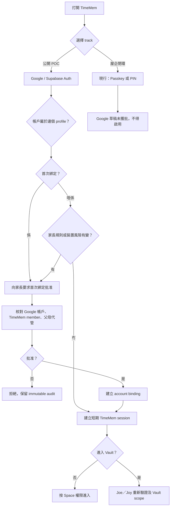

# M1 Google 登入流程圖草稿

> **狀態：REVIEW ONLY / DRAFT / 未批准**  
> PRD V10.2 及 D-032 仍以屋企閉環 Passkey + PIN 為現行方向；Google Auth 只係公開 POC 候選／D-032 提議。  
> 未決定前唔可以實作、唔可以改現行登入政策。

## 目的

草稿回應 Joe 提議：大人同細路各自用自己 Google 帳戶登入；家長只喺高風險操作批准，唔係每次登入都插手。

## 總流程

## 大人流程

1. 大人使用自己 Google 帳戶登入，Google 驗證完成。
2. 系統只接收最少 identity claims：穩定 subject、帳戶電郵、驗證狀態；唔拎 Gmail 內容。
3. subject 必須已綁定單一 TimeMem `member`。
4. 首次綁定由 Joe／Joy 核對姓名、角色、Space owner 同受影響權限。
5. 日常登入唔需要第二個大人批准。
6. 登入新裝置、移除 Passkey、恢復帳戶或加入高風險 scope 時，需要家長／管理者確認。
7. TimeMem 管理 session 唔等於自動獲得私人內容；Option B 仍適用。

## 細路仔流程

1. 細路使用自己 Google 帳戶，唔共用大人帳戶。
2. 首次加入由父母確認該 Google subject 屬於邊位小朋友。
3. 父母設定 `manager_id`、可見 Space、MCP scope、session 時限及裝置。
4. Josie／Jolie 可先由父母代管，實際 account activation 屬後續 milestone。
5. Ailene 預設只見 `Family Shared`；要 Vault 必須 request。
6. 細路唔可自行：
   - 連接新 Google 帳戶。
   - 改綁定 subject。
   - 加 Cloud MCP。
   - 搬私人 Item 去 `Family Shared`。
   - unlock Vault。
   - 改家長管理權限。

## 必須家長批准嘅位

| 操作 | 原因 |
|---|---|
| 首次 Google account binding | 避免錯綁或冒認 |
| 細路帳戶 activation／停用 | 改變可登入身份 |
| 新裝置第一次登入 | 裝置風險同 cache |
| Cloud／MCP 新 scope | 防止私人資料外送 |
| 私人 Item → `Family Shared` | 提高曝光 |
| Item → 另一人私人 Space | 需要來源同 destination owner |
| Vault request／unlock recovery | 高敏感安全區 |
| Google 帳戶 recovery 後重新綁定 | 防 takeover |
| session／裝置 revoke 例外 | 安全事件處理 |

## Session 同撤銷

- Google token 只用於驗證身份，唔保存為永久登入權。
- TimeMem 自己發短期 session；Google refresh token 是否需要留存，要另行安全 review。
- logout 清除本機加密 cache。
- 裝置或 session revoke 立即失效 Google bootstrap 後嘅 TimeMem session。
- Tailscale 可達性唔等於 TimeMem login。
- Google 斷線唔可令屋企閉環完全唔用；離線依賴係 D-032 blocker。

## Recovery

- Google 忘記密碼、二步驗證遺失、帳戶停用時，先禁止 self-rebind。
- Joe/Joy 經明確支援程序核實身份後，才重新綁定新 subject。
- recovery action 一律顯示警告同寫 immutable audit。
- 唔可以用 Vault 文件代替 Google recovery 證明，除非另行批准。

## REVIEW 問題

- 最終選 `Passkey/PIN only`、`Google only`，定 `Google optional bootstrap/recovery`。
- 屋企閉環可唔可以依賴 Google；斷網期間點登入。
- 兒童 Google account 類型、家長監管同 account recovery 點做。
- 如何撤銷 Google 同 TimeMem 之間 binding。
- Vault／break-glass 是否要求完全本機重新驗證。

