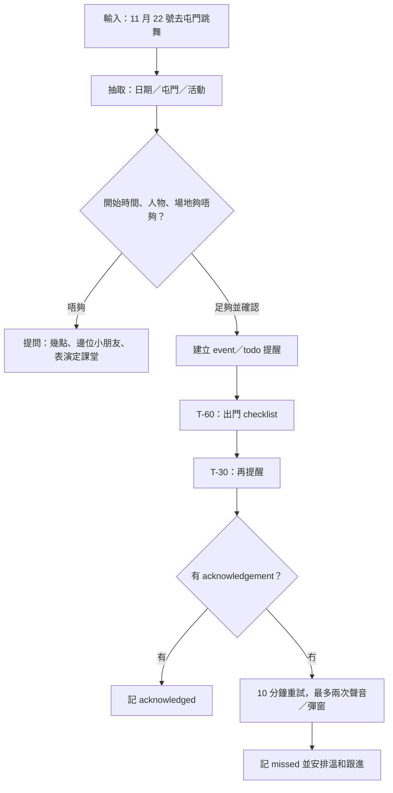

# M1 Reminder 分類草稿

> **狀態：REVIEW ONLY / 草稿 / 未批准**  
> 基於 D-030 同 Joe 例子整理；只設計分類，唔代表提醒排程、手機 OS alarm 或 schema 已批准。

## 11 月 22 號屯門跳舞例子

假設來源：「11 月 22 號，帶小朋友去屯門跳舞。」

呢句只提供日期、地點及活動類型；原文冇明確年份、開始時間、邊位小朋友、場地地址、要帶物品、表演定課堂。低於足夠信心時要問，唔可以靜靜補完。

| 維度 | 可抽取值 | 信心／處理 |
|---|---|---|
| 日期時間 | 11 月 22 日 | 假如系統日期可確定年份，仍要用家確認；開始／結束時間未知，必須問 |
| 地點 | 屯門 | 區名已知；詳細場地、地址、交通時間未知 |
| 人物 | Joe + 未指定小朋友 | 應列候選 `Josie`／`Jolie`；未確認唔直接寫 |
| 活動 | 跳舞 | 要判斷係跳舞班、排練、比賽定表演；原文唔足夠 |
| 物品 | 舞鞋、服裝、表演用品為候選 | 只可按已批准 teach defaults 建議，唔自動當真 |
| 緊急程度 | 候選「高」 | 因外出、帶小朋友及可能表演；最終由時間、已知開始前準備及未確認物品決定 |

## 時間分類

| 類型 | 觸發 | 預設行為 |
|---|---|---|
| 出門前 checklist | 到達交通預備時間 | T-60 提醒；顯示地點、人物、所需物品 |
| 到時提醒 | 事件開始前 | T-30 再提醒及 checklist |
| 現場即時提醒 | 到達 geofence 或 event time | 因只係 reachable-device 保證，未批准離線手機 OS alarm |
| 逾期跟進 | event time 已過但冇 acknowledgement | 記 `missed`，稍後溫和跟進 |
| 自訂提醒 | 使用者 override | 每個 event/todo 可改，但顯示預設來源 |

## 地點分類

| 類型 | 例子 | 資料要求 |
|---|---|---|
| 區域 | 屯門 | 原文足夠；不應憑字自動選詳細地址 |
| 場地 | 學校、舞蹈室、表演場地 | 需要正式名稱或地圖確認 |
| 出發地 | 屋企／學校／其他 | 用於計交通時間；現階段唔自動讀裝置位置 |
| 現場觸發 | 已到達指定場地 | geofence 精度、私隱同 OS 權限另行 review |

## 人物分類

- `owner`：事件主責人，例如 Joe。
- `participant`：出席者，例如 Josie、Jolie。
- `contact`：老師、導師、主辦方；只保存最少資料。
- `guardian`：需要陪同、接送或批准嘅人。
- 未能確認時列 2–3 個候選；唔可以因同名或單一 Space 推測人物。
- Reminder recipient 同事件人物唔一定一樣。

## 緊急程度

| 級別 | 判斷條件草案 | 提醒方式 |
|---|---|---|
| 低 | 仍有多日、冇時限物品、資料完整 | 到預設時間提示 |
| 中 | 同日或翌日、需要準備物品 | T-60 + T-30 + checklist |
| 高 | 即將出門、表演／比賽、未認領重要物品 | T-60／T-30 之外可顯示現場 action |
| 危急 | 系統政策或未來經批准嘅醫療／安全情境 | 不能由本草稿自行定義 |

「緊急」唔由活動名稱單獨決定，必須結合剩餘時間、地點、確認人物、物品同 event state。

## acknowledgement 規則

1. T-60 第一次提醒。
2. T-30 再次提醒並顯示 checklist。
3. event time 要求 acknowledgement。
4. 使用者回覆「已帶」或「已到」時記 `acknowledged`。
5. 冇回應時每 10 分鐘重提一次。
6. 連續兩次冇回應後停止重複聲音／彈窗，記 `missed`。
7. 稍後作溫和跟進，唔保持無限震動。

## 11 月 22 號流程示例

## 測試重點

- 原句冇時間、冇人物時，必須澄清。
- 屯門區只係區域，唔捏造地址。
- 改換 Josie／Jolie 時，提醒 recipient 同 participant 要跟住改。
- T-60、T-30、event time、重試同 `missed` 可重現。
- 電話斷網時只承諾 reconnect 後補 `missed` state，唔宣稱 OS alarm。

