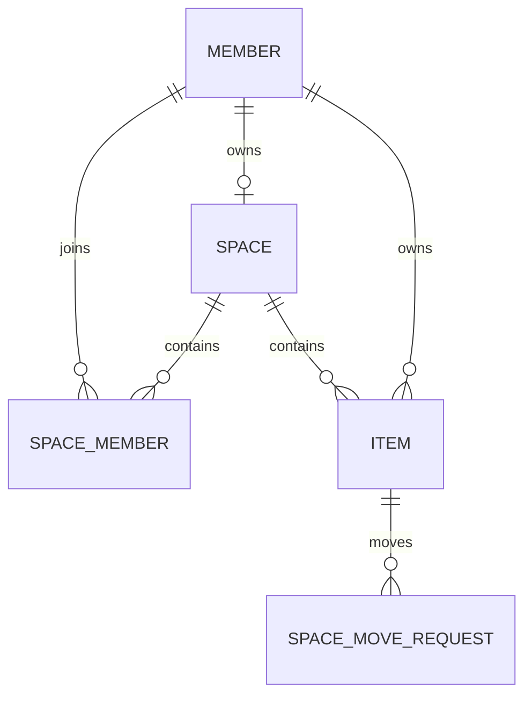

# M1 Space 資料表設計草稿

> **狀態：REVIEW ONLY / 草稿 / 未批准**  
> 本設計只係 Option B 同 D-026 嘅 review 草稿，唔係 migration、API contract 或權限實作批准。  
> Option B：System Admin 唔會因管理身份自動讀私人內容；受控讀取需要明確理由、事前警告及 immutable audit log。

## 設計原則

- 六個初始 Space：`Joe`、`Joy`、`Josie`、`Jolie`、`Ailene` 各一個私人 Space，加 `Family Shared`。
- 每個 Item 同一時間只屬一個 Space。
- Member 同 Space 用關聯表連接，唔用 UUID array。
- Item owner 係建立／持有人概念，唔等於永遠有權讀取 Item；實際權限仍按 Item 現時所屬 Space 計。
- 搬 Space 係更新 `item.space_id`，唔用 copy 掩飾 duplicate。
- Ailene 預設只見 `Family Shared`。

## 建議資料實體

| 實體 | 建議主要欄位 | 用途／規則 |
|---|---|---|
| `member` | `id`, `display_name`, `account_status`, `manager_id`, `created_at`, `deleted_at` | 家庭成員；細路 activation 可以遲啲處理，`manager_id` 表示家長代管 |
| `space` | `id`, `kind`, `name`, `owner_member_id`, `created_at`, `deleted_at` | `kind` 為 `private` 或 `family_shared`；Family Shared 冇單一 owner |
| `space_member` | `space_id`, `member_id`, `role`, `status`, `granted_by`, `created_at`, `revoked_at` | 表示可見／管理關係；`role` 可分 `owner`、`member`、`manager`、`viewer` |
| `item` | `id`, `space_id`, `owner_member_id`, `item_type`, `title`, `status`, `created_by`, `created_at`, `updated_at`, `deleted_at` | `space_id` 必須存在；每行只有一個 Space |
| `space_move_request` | `id`, `item_id`, `from_space_id`, `to_space_id`, `requested_by`, `status`, `source_approved_by`, `destination_approved_by`, `confirmation_expires_at` | 保存搬移過程，支援雙方批准同取消 |
| `admin_access_request` | `id`, `actor_id`, `target_space_id`, `item_id`, `reason`, `warning_shown_at`, `approved_at`, `expires_at`, `status` | Option B 受控讀取，唔允許管理身份直接 bypass |
| `immutable_audit` | `id`, `event_type`, `actor_id`, `target_type`, `target_id`, `reason`, `result`, `occurred_at`, `integrity_hash` | 讀私人資料同搬 Space 要留紀錄；不可靜默刪 |

## 關係

## 搬 Space 規則

| 情況 | 需要批准 | UI 必須顯示 |
|---|---|---|
| 自己 Item → 自己私人 Space | 登入者即可 | 來源、目的、搬移後邊個可見 |
| `Family Shared` Item → 自己私人 Space | Item owner 或持有人確認 | 共享曝光會減少；唔用 duplicate |
| 私人 Space → `Family Shared` | Item owner，5 秒倒數，第二次確認 | 清楚顯示來源、目的、會公開畀家庭成員 |
| 私人 Space → 另一人私人 Space | 來源 owner + destination owner | 雙方批准狀態；未齊唔搬 |
| 子女 Space | 父母可按代管規則操作，但唔可任意公開 | 代管人身份、代理對象、理由 |

### 原子操作要求

- 檢查 Item 存在、現有 Space、來源權限、目的權限。
- 單一 transaction 更新 `item.space_id` 同寫 audit event。
- 更新前鎖定 Item，避免兩個 session 同時搬。
- 失敗時 rollback，唔留下 Item 冇 Space 嘅狀態。
- 唔建立第二份 Item；重試要用 idempotency key。

## Option B 管理讀取

1. 管理者搜尋支援或救急問題，但預設唔顯示其他私人 Space 內容。
2. 如需受控讀取，先填明確理由同目標 Item／Space。
3. UI 顯示高風險警告：閱讀會留不可靜默刪嘅 audit，並限制時段。
4. 通過當時批准嘅驗證後，短暫開啟指定讀取範圍。
5. 到期、登出、撤銷或完成任務後即時失效。
6. Backup 操作只處理加密資料，唔等於 plaintext 讀取權。

## 建議約束

- `item.space_id` 為 `NOT NULL`。
- 只允許一個 current Space；`space_move_request` 唔等於 Item 同時屬兩個 Space。
- `space_member` 同 `(space_id, member_id)` 唯一。
- `deleted_at` 唔允許用嚟繞過權限；查詢預設過濾已刪資料。
- DB constraint 及 authorization policy 要分開保護；UI 隱藏按鈕唔可當安全控制。

## 未決事項

- 角色同權限矩陣細項。
- 父母代管、小朋友 activation 同撤銷流程。
- `Family Shared` 修改者能否刪除其他人建立嘅 Item。
- 跨私人 Space 搜尋索引點樣防 metadata leakage。
- 受控讀取幾多時間有效，以及 Vault 同普通 Space 可唔可以共用 request 流程。

